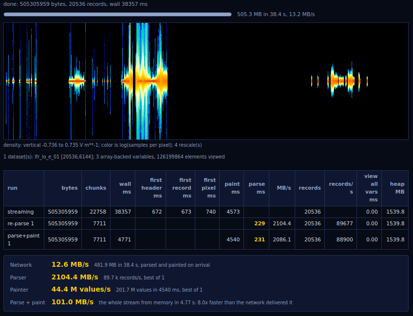

# das2js

Das servers typically provide data relevant to space plasma and magnetospheric
physics research.  To retrieve data, an HTTP GET request is posted to a das
server by a client program and a self-describing stream of data values covering
the requested time range, at the requested time resolution, is provided in the
response body.  This project aims to read those streams in web browsers by
compiling [das2C](https://github.com/das-developers/das2C) to WebAssembly, so
parsing and value decoding happen in C and JavaScript receives typed-array
views of the decoded values without a conversion pass.

**Early days, but it runs.**  `make` produces a three-file ES module
in `build.wasm32/` (`das2js.mjs`, `das2c.mjs`, `das2c.wasm`) that fetches a
das stream, parses it as it arrives, and hands back decoded values, int64 and 
all.  It has read real data from a public dasFlex server in Firefox.  No package,
no minified build, no catalog browser, no plotting; a progress meter, a source
picker, a catalog tree view and a live spectrogram are the planned demos. 
Layout:

  * `src/` - the hand-written ES module, one file
  * `glue/` - a small flat C interface over das2C, the wasm export surface
  * `test/` - the glue test (wasm under node) and the browser tests
    (headless Firefox via a node runner)
  * `deps/` - das2C, pinned as a git submodule and compiled in; it fetches
    and builds expat and FFTW for wasm32 itself
  * `notes/` - build recipe, measurements

**It is fast.**  A full day of Juno Waves burst waveforms, 505 MB of
samples, parses in Firefox in under 300 ms once the bytes are in memory,
about 1.7 GB/s, and the first record is usable half a second after the
request goes out while the server spends the next 36 s producing the rest.
No JSON on the wire, no number conversion in JavaScript: the values arrive
in their native binary encoding and the browser reads them as they are.  
Screenshot of the live run below. Method and more streams in 
[notes/performance.md](notes/performance.md).

Like the other das2C bindings (das2py, das2dlm) this project compiles a
pinned das2C commit in rather than linking a system copy.  Until das2C
v3.0.0 is tagged that commit is on das2C master.  `notes/build.md` covers
the toolchain, the build and the tests; `git submodule update --init`
fetches the pinned sources.

This repository was started in 2022 and promptly went dormant.  It is active
again as of October 2026, though if you need a working das client today,
das2py is the mature path and this is not yet an alternative.
